<picture>
  <source media="(prefers-color-scheme: dark)" srcset="assets/hero-dark.svg">
  
</picture>

 

**18. Electronics student in Neuchâtel, Switzerland.**

I design PCBs, write firmware in C and build hardware that actually does something. Not just software on a screen.

Datasheet first, register by register. If I don't understand how something works, I take it apart until I do.

Off the bench: FPV drones, running, mountains.

 

## What I'm building right now

<picture>
  <source media="(prefers-color-scheme: dark)" srcset="assets/building-dark.svg">
  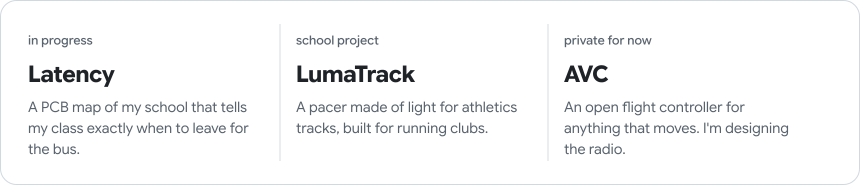
</picture>

 

## What I'm learning

Rated honestly, updated as I go.

<picture>
  <source media="(prefers-color-scheme: dark)" srcset="assets/learning-dark.svg">
  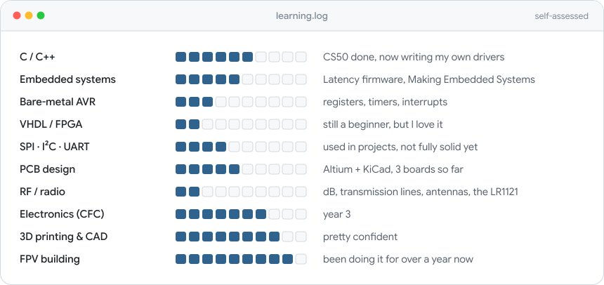
</picture>

 

## Already built

<a href="https://github.com/merlin-rce/Dyce#gh-dark-mode-only">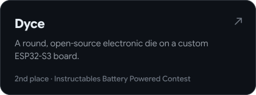</a><a href="https://github.com/merlin-rce/Dyce#gh-light-mode-only">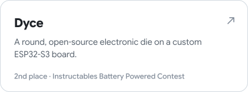</a>
<a href="https://github.com/merlin-rce/HARDuino#gh-dark-mode-only">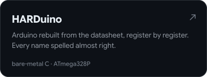</a>

<a href="https://github.com/merlin-rce/esp32_SK6812#gh-dark-mode-only">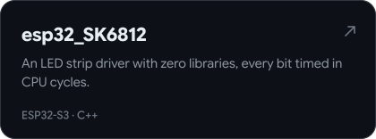</a><a href="https://github.com/merlin-rce/esp32_SK6812#gh-light-mode-only">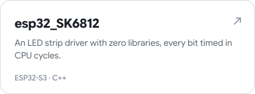</a>
<a href="https://github.com/merlin-rce/smart-candy-pumpkin#gh-dark-mode-only">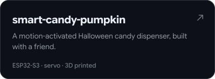</a><a href="https://github.com/merlin-rce/smart-candy-pumpkin#gh-light-mode-only">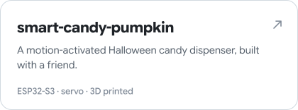</a>

 

## Toolbox

<picture>
  <source media="(prefers-color-scheme: dark)" srcset="assets/tools-dark.svg">
  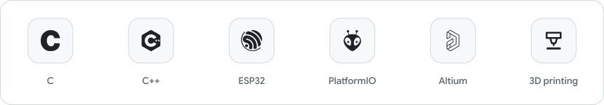
</picture>

 

---

If you want to support a student who spends his weekends soldering and crashing drones xD → <a href="https://buymeacoffee.com/merlin.rce">buy me a coffee</a>
  
Built in Switzerland by <a href="https://github.com/merlin-rce">merlin-rce</a>, learning as I go.

